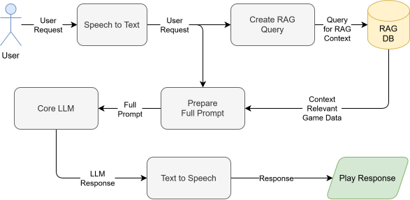

# Game Assistant - System Architecture

## Overview

The Game Assistant is a Speech-to-Speech (STS/S2S) AI system designed to help users with game-related questions through voice interaction.

## System Architecture

### Architecture Flow Diagram



[Open documentations folder](data/documentation/)

## Component Details

### 1. Speech-to-Text Module
- **Technology**: OpenAI Whisper
- **Purpose**: Convert user voice input to text
- **Models**: tiny, base, small
- **Features**: 
  - Multi-language support
  - High accuracy
  - Local processing (no external API)

### 2. RAG Database Module
- **Technology**: ChromaDB
- **Purpose**: Store and retrieve game information
- **Features**:
  - Vector-based semantic search
  - Document chunking and embedding
  - Persistent storage
  - Context retrieval for LLM

### 3. LLM Processor Module
- **Technology**: Qwen3-4b-instruct
- **Purpose**: Generate intelligent responses
- **Features**:
  - Instruction-following capabilities
  - Context-aware responses

### 4. Text-to-Speech Module
- **Technology**: pyttsx3
- **Purpose**: Convert text responses to speech
- **Features**:
  - Offline TTS processing
  - Cross-platform compatibility
  - Customizable voices and speech rates
  - No external API calls (local processing)
  

## Data Flow

```
User Voice 
  → STT (transcribe) 
  → RAG Query 
  → Retrieve Context 
  → LLM Processing 
  → TTS (synthesize) 
  → Voice Output
```

## File Structure

```
game-assistant/
├── src/
│   ├── main.py              # Application orchestrator
│   ├── config.py            # Configuration management
│   ├── utils/               # Utility functions and helpers
│   └── modules/
│       ├── speech_to_text.py     # STT module
│       ├── rag_database.py       # RAG module
│       ├── llm_processor.py      # LLM module
│       ├── text_to_speech.py     # TTS module
│       └── assistant_gui.py      # GUI module
├── data/
│   └── game_info/           # Game knowledge base
│       ├── guides/              # Game guides and walkthroughs
│       └── recipes/             # Game item crafting recipes
├── tests/                   # Testing
│   └──instances/            # Files for testing (audio, text, etc.)
│       └── TODO
│
├── environment.yml          # Conda environment for easier venv usage (optional)
└── requirements.txt         # Python dependencies
```

## Configuration

TODO

## Deployment

TODO

## References

- [OpenAI Whisper](https://github.com/openai/whisper)
- [LangChain](https://python.langchain.com/)
- [ChromaDB](https://www.trychroma.com/)
- [pyttsx3](https://pyttsx3.readthedocs.io/en/latest/)
- [Qwen3-4b-instruct](https://ollama.com/library/qwen3:4b-instruct)
- [tkinter](https://docs.python.org/3/library/tkinter.html)

