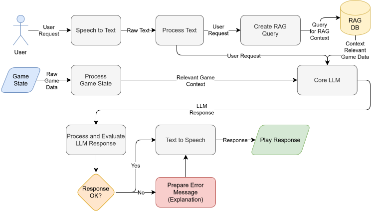

# Game Assistant - System Architecture

## Overview

The Game Assistant is a Speech-to-Speech (S2S) AI system designed to help users with game-related questions through voice interaction.

## System Architecture

### Architecture Flow Diagram



[Open documentations folder](data/documentation/)

## Component Details

### 1. Speech-to-Text Module
- **Technology**: OpenAI Whisper
- **Purpose**: Convert user voice input to text
- **Models**: tiny, base, small
- **Features**: 
  - Multi-language support
  - High accuracy
  - Local processing (no external API)

### 2. RAG Database Module
- **Technology**: LangChain + ChromaDB + Sentence Transformers
- **Purpose**: Store and retrieve game information
- **Features**:
  - Vector-based semantic search
  - Document chunking and embedding
  - Persistent storage
  - Context retrieval for LLM

### 3. LLM Processor Module
- **Technology**: Mistral, Ollama or Qwen
- **Purpose**: Generate intelligent responses
- **Features**:
  - TODO

### 4. Text-to-Speech Module
- **Technology**: Coqui TTS
- **Purpose**: Convert text responses to speech
- **Features**:
  - Natural-sounding voice
  - Multiple voices/languages
  - Adjustable speed
  - Audio output or file saving
  

## Data Flow

```
User Voice 
  → STT (transcribe) 
  → RAG Query 
  → Retrieve Context 
  → LLM Processing 
  → TTS (synthesize) 
  → Voice Output
```

## File Structure

```
game-assistant/
├── src/
│   ├── main.py              # Application orchestrator
│   ├── config.py            # Configuration management
│   └── modules/
│       ├── speech_to_text.py     # STT module
│       ├── rag_database.py       # RAG module
│       ├── llm_processor.py      # LLM module
│       ├── text_to_speech.py     # TTS module
│       └── TODO
├── data/
│   └── game_info/           # Game knowledge base
│       ├── TODO
│       └── TODO
├── tests/                   # Testing
│   └──instances/            # Files for testing (audio, text, etc.)
│       └── TODO
TODO:
├── Dockerfile               # Container definition
├── docker-compose.yml       # Deployment config
├── environment.yml          # Conda environment for easier venv usage (optional)
└── requirements.txt         # Python dependencies
```

## Configuration

TODO

## Deployment

### Docker Deployment
```bash
docker build -t game-assistant .
docker run -it -e game-assistant
```

### Local Deployment
```bash
pip install -r requirements.txt
python src/main.py
```

## References

- [OpenAI Whisper](https://github.com/openai/whisper)
- [LangChain](https://python.langchain.com/)
- [ChromaDB](https://www.trychroma.com/)
- [Coqui TTS](https://github.com/coqui-ai/TTS)

