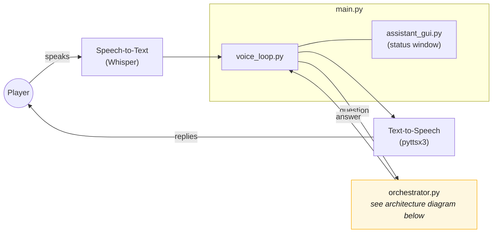
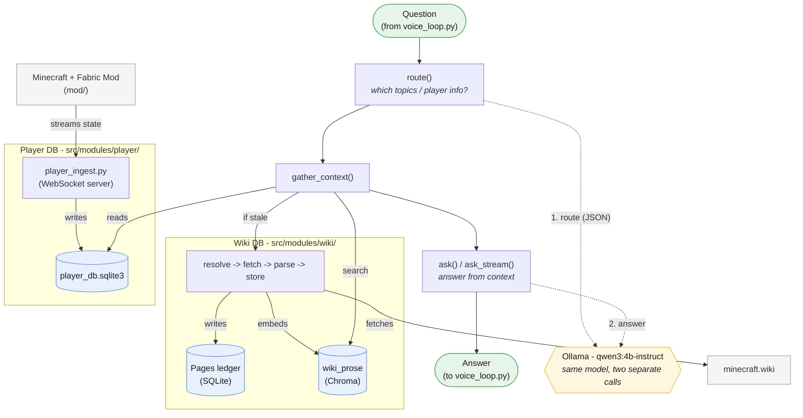

# Game Assistant

[](https://github.com/lufeld/game-assistant/actions/workflows/tests.yml)

A local, voice-driven Minecraft assistant. It answers questions about game
mechanics by reading the [Minecraft Wiki](https://minecraft.wiki) on demand
(cached locally after the first lookup), and answers questions about your
own game state (inventory, position, health, deaths, ...) by reading live
data streamed out of the game by a companion Fabric mod. Everything runs
locally - speech recognition, the LLM (via [Ollama](https://ollama.com)),
and text-to-speech all run on your own machine, with no cloud services
involved.

## Architecture

The live voice loop - listening, handing the question off, speaking the
reply. "orchestrator.py" here is a black box; see the second diagram below
for what's actually inside it.



The assistant itself: a router, not an agent. `route()` and `ask()` are two
separate calls to the *same* model, doing two different jobs - the model
never decides how to retrieve anything, plain Python code in
`gather_context()` does that deterministically.

The two data stores it
reads from - the wiki DB and the player DB - are populated completely
differently:

+ The wiki DB is filled lazily, on demand, by fetching from minecraft.wiki the first time a topic is actually asked about.

+ The player DB is filled continuously, in the background, by the Fabric mod streaming the live game state to `player_ingest.py` while playing.



The answer streams back sentence-by-sentence as it's generated, not all at
once - the voice loop starts speaking the first sentence while the model is
still generating the rest.

Note that `player_ingest.py` (bottom-left of the second diagram) is a
separate process from the voice assistant - **it does not start
automatically**, see [Running it](#running-it) below.

A separate, second orchestrator in [`src/modules/agent/`](src/modules/agent/README.md)
explores a different architecture for the same job - a bigger model
reactively calling tools multiple times per turn instead of one fixed
routing + retrieval pass - as a comparison, not a replacement. It's not
wired into the voice loop; see its own README for the architecture,
what's been learned from testing it, and how to run it.

## Setup

1. **Python 3.10+**, then install dependencies:

   ```
   pip install -r requirements.txt
   ```

2. **[Ollama](https://ollama.com)**, installed and running, with the model
   pulled:

   ```
   ollama pull qwen3:4b-instruct
   ```

3. **The Minecraft mod** (optional - only needed for questions about your
   own game state, not for wiki questions) - see [mod/README.md](mod/README.md)
   for building, installing, and debugging it.

## Running it

Three independent processes, started separately:

```
python src/main.py                      # the voice assistant itself
python src/modules/player/player_ingest.py   # player-state ingest server (optional)
```

...plus Minecraft itself, with the mod installed, if you're running the
ingest server. `main.py` opens a small status window, warms up the model on
startup (so the cold-load delay happens before you start talking, not on
your first question), then listens continuously until you say "exit",
"quit", or "goodbye".

Without a live Minecraft session, you can still exercise the player-state
side end to end using the simulator:

```
python src/modules/player/player_ingest.py &
python src/modules/player/player_simulate.py   # sends src/modules/player/player_events_sample.jsonl
```

## Testing

```
pytest
```

91 tests as of this writing, covering the wiki pipeline (`src/modules/wiki/tests/`),
the player-state pipeline (`src/modules/player/tests/`), and the agent
orchestrator's loop control-flow (`src/modules/agent/tests/`) - the first two
against real I/O (a tmp SQLite DB, an actual WebSocket connection) rather
than mocks, the agent tests via a real injected `chat_fn` standing in for
the Ollama network boundary. `orchestrator.py` and the voice loop are
exercised manually - see `src/modules/orchestrator_prompts.txt` for a batch
of test questions
(`python src/modules/orchestrator.py --batch src/modules/orchestrator_prompts.txt`).
The agent orchestrator has its own batch file and README - see
[`src/modules/agent/README.md`](src/modules/agent/README.md).

## Project layout

```
src/
  main.py                    entrypoint: wires GUI + STT + TTS + the voice loop together
  modules/
    orchestrator.py          route -> ensure -> retrieve -> answer pipeline
    orchestrator_prompts.txt batch test questions for orchestrator.py --batch
    voice_loop.py             the live STT -> orchestrator -> TTS loop
    assistant_gui.py          Tkinter status window + conversation log
    speech_to_text.py         Whisper-based listen-until-silence transcription
    text_to_speech.py         pyttsx3 wrapper
    wiki/                     lazy wiki ingestion (resolve/fetch/parse/store) + Chroma
    player/                   player state: player_db.py, player_ingest.py, player_simulate.py
    agent/                    comparison POC: reactive tool-calling orchestrator - see agent/README.md
mod/                          the Fabric mod (separate Gradle/Java project - see mod/README.md)
data/                         created at runtime: player_db.sqlite3, game_db.sqlite3,
                              chroma_db/, wiki_cache/ - all gitignored, all rebuildable
```

## Future work

**Orchestration**
- Polish the ReAct agent - the open findings already written up in
  [`src/modules/agent/README.md`](src/modules/agent/README.md) (inconsistent
  skill consultation, the registry-id/wiki-title mismatch below) are
  concrete starting points.
- Add more orchestrator architectures to the comparison - e.g. a planner
  that commits to an explicit multi-step plan before executing it, instead
  of the current reactive one-tool-at-a-time design.
- A hybrid orchestrator: route fast, single-hop questions through the
  router, and hand off to the agent only when a question actually needs
  chained lookups.
- An evaluation set with expected answers, to measure accuracy and latency
  instead of judging batch output by eye.

**Multiplayer** (sequential - each step depends on the last)
1. Move the Fabric mod from client-side-only to a server-side mod, so it
   can see every connected player instead of just the one running it.
2. Rework the Player DB schema to key every table by player - it currently
   assumes exactly one player's state throughout.
3. Share player state across users so the assistant can answer about more
   than one player at once - e.g. "where is PlayerX?", or an answer that
   draws on more than one player's inventory for a shared build.

**Smarter interaction**
- Proactive mode: react to events from the live game-state stream instead
  of only answering when asked - e.g. a low-health or nightfall warning.
- Player-adapted detail: learn how experienced a player is and adjust
  answer depth/length accordingly, instead of fixed verbosity for everyone.
- Player profile memory: let a player tell the assistant things to
  remember across sessions ("remember this location, I want to build a
  base here"). This is a stated preference/intent, not a fact about
  current or past game state, so it likely needs its own store rather than
  living in the Player DB.

**Voice & UI**
- Polish `assistant_gui.py`'s status window - it's currently a minimal
  Tkinter window (status text + conversation log); clearer visual states
  for listening/thinking/speaking, and maybe a live input-level indicator,
  would make it nicer to actually use while playing.
- Let the user pick input/output devices (microphone, speakers/headset)
  instead of relying on whatever the OS considers the default - useful for
  anyone running a game headset alongside regular speakers.
- Evaluate alternative TTS engines. `pyttsx3` wraps the OS's own built-in
  voice (SAPI5 on Windows) and sounds noticeably robotic next to modern
  local neural TTS. Piper (Rhasspy's local TTS engine) is a reasonable
  first candidate to prototype against - fully offline, fits the project's
  no-cloud constraint, and is already name-checked as a direction in
  `documentation/presentation.md`'s own future-work notes.

**Data quality**
- Bridge registry ids and wiki titles project-wide. The agent's
  `player_find_items`/`player_find_placements` already normalize this
  locally (`minecraft:cooked_beef` vs. "Cooked Beef"), but the router's
  `player_db` lookups don't, and there's no shared, reusable mapping either
  side draws on.
- Revisit `resolve.py`'s search-fallback alias cache - a fuzzy-search guess
  gets permanently remembered for that term (`aliases.json`) with no
  expiry or distinction from a confirmed direct/redirect match. Known
  concrete case: "repair sword" resolves to "Mending" instead of the
  better-fitting "Item repair".
- Better retrieval: page/section context in the embeddings, smaller
  chunks, a re-ranker - the right chunk is usually in the top-5 today, not
  reliably at #1.

**Project health**
- Evaluate higher Python versions (+packages) and/or PyPy for faster startup and lower memory usage.
- Automated coverage for the router and voice loop - the wiki/player/agent
  modules have real pytest coverage against real I/O; the router is still
  exercised manually via batch prompt files.

