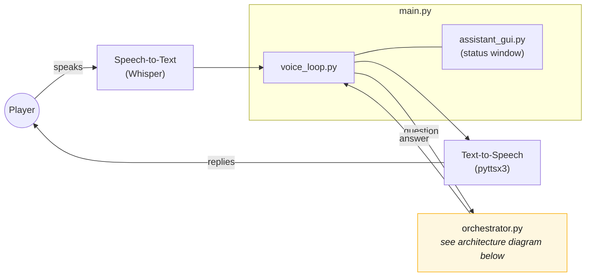

# Game Assistant

A local, voice-driven Minecraft assistant. It answers questions about game
mechanics by reading the [Minecraft Wiki](https://minecraft.wiki) on demand
(cached locally after the first lookup), and answers questions about your
own game state (inventory, position, health, deaths, ...) by reading live
data streamed out of the game by a companion Fabric mod. Everything runs
locally - speech recognition, the LLM (via [Ollama](https://ollama.com)),
and text-to-speech all run on your own machine, with no cloud services
involved.

## Architecture

The live voice loop - listening, handing the question off, speaking the
reply. "orchestrator.py" here is a black box; see the second diagram below
for what's actually inside it.



The assistant itself: a router, not an agent. `route()` and `ask()` are two
separate calls to the *same* model, doing two different jobs - the model
never decides how to retrieve anything, plain Python code in
`gather_context()` does that deterministically.

The two data stores it
reads from - the wiki DB and the player DB - are populated completely
differently:

+ The wiki DB is filled lazily, on demand, by fetching from minecraft.wiki the first time a topic is actually asked about.

+ The player DB is filled continuously, in the background, by the Fabric mod streaming the live game state to `player_ingest.py` while playing.


The answer streams back sentence-by-sentence as it's generated, not all at
once - the voice loop starts speaking the first sentence while the model is
still generating the rest.

Note that `player_ingest.py` (bottom-left of the second diagram) is a
separate process from the voice assistant - **it does not start
automatically**, see [Running it](#running-it) below.

## Setup

1. **Python 3.10+**, then install dependencies:

   ```
   pip install -r requirements.txt
   ```

2. **[Ollama](https://ollama.com)**, installed and running, with the model
   pulled:

   ```
   ollama pull qwen3:4b-instruct
   ```

3. **The Minecraft mod** (optional - only needed for questions about your
   own game state, not for wiki questions) - see [mod/README.md](mod/README.md)
   for building, installing, and debugging it.

## Running it

Three independent processes, started separately:

```
python src/main.py                      # the voice assistant itself
python src/modules/player/player_ingest.py   # player-state ingest server (optional)
```

...plus Minecraft itself, with the mod installed, if you're running the
ingest server. `main.py` opens a small status window, warms up the model on
startup (so the cold-load delay happens before you start talking, not on
your first question), then listens continuously until you say "exit",
"quit", or "goodbye".

Without a live Minecraft session, you can still exercise the player-state
side end to end using the simulator:

```
python src/modules/player/player_ingest.py &
python src/modules/player/player_simulate.py   # sends src/modules/player/player_events_sample.jsonl
```

## Testing

```
pytest
```

73 tests as of this writing, covering the wiki pipeline (`src/modules/wiki/tests/`)
and the player-state pipeline (`src/modules/player/tests/`) against real I/O
(a tmp SQLite DB, an actual WebSocket connection) rather than mocks.
`orchestrator.py` and the voice loop are exercised manually - see
`src/modules/orchestrator_prompts.txt` for a batch of test questions
(`python src/modules/orchestrator.py --batch src/modules/orchestrator_prompts.txt`).

## Project layout

```
src/
  main.py                    entrypoint: wires GUI + STT + TTS + the voice loop together
  modules/
    orchestrator.py          route -> ensure -> retrieve -> answer pipeline
    orchestrator_prompts.txt batch test questions for orchestrator.py --batch
    voice_loop.py             the live STT -> orchestrator -> TTS loop
    assistant_gui.py          Tkinter status window + conversation log
    speech_to_text.py         Whisper-based listen-until-silence transcription
    text_to_speech.py         pyttsx3 wrapper
    wiki/                     lazy wiki ingestion (resolve/fetch/parse/store) + Chroma
    player/                   player state: player_db.py, player_ingest.py, player_simulate.py
mod/                          the Fabric mod (separate Gradle/Java project - see mod/README.md)
data/                         created at runtime: player_db.sqlite3, game_db.sqlite3,
                              chroma_db/, wiki_cache/ - all gitignored, all rebuildable
```
