<style>
@import url('https://fonts.googleapis.com/css2?family=Press+Start+2P&display=swap');

section { font-size: 30px; }
section h1 { margin-bottom: 0.45em; }
section strong { color: var(--color-highlight); }
section em { color: var(--color-dimmed); }
section h1 strong { color: var(--color-highlight); }
section code { background: #e3f2fd; color: #01579b; }
/* block fences (```) use a separate, higher-specificity gaia rule that the
   plain "section code" override above doesn't reach - measured its actual
   rendered colors (#455a64 bg, ~#015884 text) at 1.06:1 contrast, same
   problem as the inline code pill had. Same verified pairing as above,
   6.48:1; pre code's own background is cleared so it doesn't double up. */
section pre { background: #e3f2fd; }
section pre code { background: transparent; color: #01579b; }
section img, section figure { image-rendering: pixelated; }
section ul > li > ul > li { margin-top: 0.1em; }

/* chapter label in the top-left corner */
header {
  font-family: 'Press Start 2P', monospace;
  font-size: 13px;
  color: var(--color-highlight);
  padding-top: 24px;
  letter-spacing: 1px;
}

/* denser slides */
section.small { font-size: 24px; }
section.small h1 { font-size: 1.9em; }

/* tables */
section table { font-size: 0.8em; width: 100%; display: table; }
section table th, section table td { padding: 0.35em 0.6em; text-align: left; }
section table td code { font-size: 0.85em; }

/* blockquotes are spoken player questions */
section blockquote { font-style: italic; margin-top: 0.6em; }

/* two columns: heading and lists span both, everything else fills a cell */
section.cols {
  display: grid;
  grid-template-columns: 1fr 1fr;
  column-gap: 32px;
  align-content: start;
}
section.cols > h1, section.cols > ul { grid-column: 1 / -1; }
section.cols > p { margin: 0.2em 0 0 0; color: var(--color-dimmed); }
section.cols > pre { margin-top: 0.3em; }

/* title + closing slides */
section.title {
  display: flex;
  flex-direction: column;
  justify-content: center;
  align-items: center;
  text-align: center;
}
section.title h1 { font-size: 2.3em; line-height: 1.15; }
section.title h2 { color: var(--color-dimmed); margin-top: 0.3em; }
section.title p { margin-top: 0.7em; }

/* chapter dividers */
section.divider {
  display: flex;
  flex-direction: column;
  justify-content: center;
  padding-left: 110px;
}
section.divider h6 {
  font-family: 'Press Start 2P', monospace;
  font-size: 60px;
  color: var(--color-highlight);
  margin: 0;
}
section.divider h1 { font-size: 2.2em; margin: 0.35em 0 0 0; }
section.divider p { color: var(--color-dimmed); font-size: 0.95em; margin-top: 0.6em; }
</style>

<!-- _class: title -->

# Agentic STS <br> Game-Assistant
## for


🎙️ ask by voice  ·  📚 knows the game  ·  🧍 knows *your* world

**Lukas A. Feldgrill**

<!--
STS = speech-to-speech: the player talks, the assistant talks back.
Everything runs locally on the player's machine next to the game.
-->

---
<!-- paginate: true -->
<!-- footer: 'Lukas A. Feldgrill | Agentic STS Game-Assistant' -->
<!-- header: '01 · Motivation & Goal' -->

# Motivation


* 🧩 New players often struggle to understand the game mechanics of Minecraft.
* 📚 The game is very complex and has many different mechanics.
* 🧭 Players lose overview of the game and often don't know what to do next.
* 🔍 Looking something up means alt-tabbing to the wiki, and the wiki knows nothing about **your** world.

<!--
The creeper: the classic "nobody told me" moment for new players.
Last point is the bridge to this phase: the Feb prototype only knew the game, not the player's world.
-->

---
<!-- _class: small -->

# Where we left off: the Feb 2026 prototype

| Prototype (Feb 2026) | Next step we named back then | Now |
|---|---|---|
| Scope: food & farming only | Expand the scope | ✅ the whole wiki, pulled on demand |
| 3 hand-written guides + recipes in Chroma | Improve RAG, maybe Graph RAG | 🔄 rebuilt; Graph RAG tried and dropped |
| Game state **not** observed | Take game state into account | ✅ Fabric mod → Player DB |
| Classify → rewrite query → answer (3 LLM calls) | Add an orchestrator | ✅ two of them: router & ReAct agent |
| Some hallucinations | Fine-tune the LLM | ⏸️ not pursued; grounding + "I don't know" instead |

<!--
The old pipeline: intent classifier ("guide" vs "recipe"), keyword rewrite, then answer - three sequential LLM calls,
retrieving from three hand-written markdown guides plus datapack recipes.
This phase was a fresh start on the knowledge + orchestration side; STT, TTS, GUI and the model were kept.
-->

---

# Goal

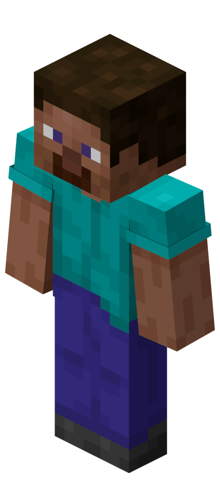

Ask by **voice**, while playing, about the **game** *and* about **your world**.

> 📚 "What does a wither skeleton drop?"
> 🧍 "Where did I put my torches?"
> 🔗 "I'm hungry, do I have any food left?"

🏠 100 % local
🎮 4 GB target · 12 GB ceiling, next to the running game
⏱️ fast enough to talk to

<!--
These three questions come back throughout the talk:
1) pure game knowledge, 2) pure player state, 3) needs both, chained: first learn what counts as food, then check the player.
Constraints: no cloud, must fit on a mid-range GPU while Minecraft itself is running, answers must arrive at conversation speed.
-->

---

# Outline

2. 🏗️ System architecture
3. 🔎 Gathering information: wiki & player
4. ⚙️ The two orchestrators in detail
5. ⚖️ Comparison
6. 💥 Drawbacks & known issues
7. 🔭 Future work

---
<!-- _class: divider -->
<!-- header: '02 · System Architecture' -->
<!-- _header: '' -->


###### 02
# System Architecture

The big picture, and two ways to run it

---

# The big picture

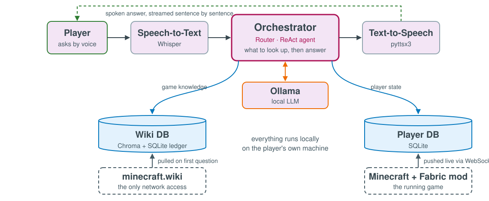

<!--
Voice loop: Whisper -> orchestrator -> pyttsx3; the answer is streamed sentence by sentence, so speech starts early.
Orchestrator is the swappable part. Both read the same two stores.
Wiki DB fills lazily from minecraft.wiki (the only network access). Player DB fills continuously from a Fabric mod.
-->

---

# Two ways to orchestrate

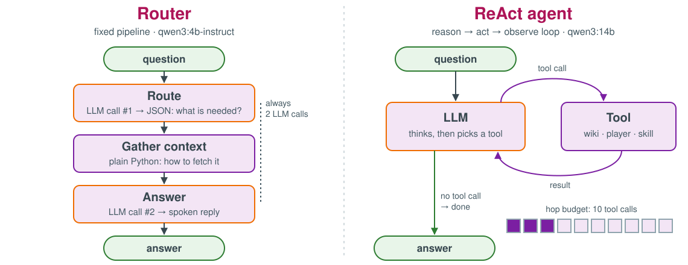

<!--
Research question: can letting the model chain lookups answer questions that need BOTH sources?

Router: the LLM decides WHAT is needed, plain code decides HOW to fetch it. Exactly two LLM calls.
ReAct agent: the LLM decides what AND how, one tool call at a time, each informed by the previous result.
The agent exists as a comparison (proof of concept), not as a replacement.
-->

---
<!-- _class: divider -->
<!-- header: '03 · Gathering Information' -->
<!-- _header: '' -->


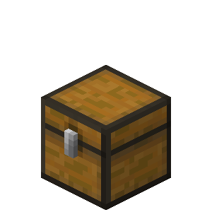

###### 03
# Gathering Information

Game knowledge from the wiki, player state from the game

---
<!-- _class: small -->

# Two sources, two strategies

| | 📚 Game knowledge | 🧍 Player state |
|---|---|---|
| **Source** | minecraft.wiki | Fabric mod in the running game |
| **Filled** | lazily, on the first question about a topic (*pull*) | continuously while playing (*push*) |
| **Stored in** | Chroma (text chunks) + SQLite ledger | SQLite (snapshots + history) |
| **Queried by** | semantic search, scoped to one page | exact lookups, no embeddings |
| **Kept fresh by** | revision-id check on every lookup | latest event wins |

<!--
Two very different kinds of data, so two very different pipelines.
Only thing they share: SQLite as the ledger.
-->

---
<!-- _class: small -->

# Why the wiki, and why lazily?


* 📦 Game files have recipes & loot tables, but no *explanations* (spawning, farming, mechanics)
* 📚 The wiki covers everything and follows every release
* 🐢 But it is huge and its wikitext is messy → don't scrape it all up front
* ♻️ **Read-through cache:** fetch a page the first time someone asks, keep it local afterwards
* 🎮 Small model: *retrieval* carries the knowledge, the LLM only phrases it

---

# The wiki pipeline

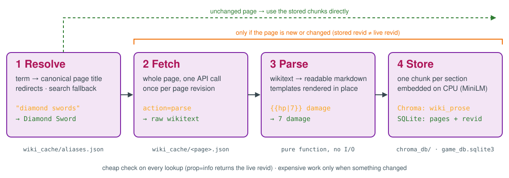

<!--
resolve.py, fetch.py, parse.py, store.py - each a plain function, tested independently.
Freshness without a TTL: prop=info returns the live revid for free; compare with the stored revid.
Two caches on purpose: wiki_cache = "raw wikitext on disk", pages ledger = "what is in Chroma right now".
After a parser fix, pages can be re-parsed and re-stored without touching the network.
-->

---
<!-- _class: small -->

# Resolving a term to a Wiki page

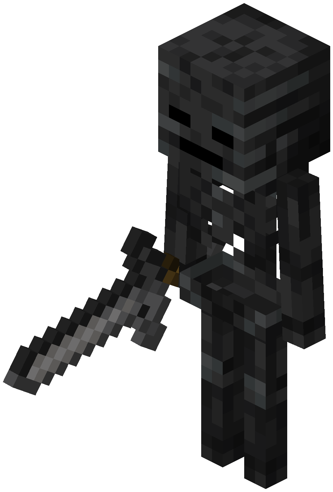

1. **Direct lookup:** one cheap `prop=info` call → exists? redirect? current revision id
2. **Miss →** full-text search, minus edition/version & franchise pages
3. Remember search hits in an alias cache

⚠️ Wiki search ranks by **keyword overlap, not meaning.**
`"black monster"` → #1 **Minicraft**, an old Notch prototype game
✅ With the franchise filter → #1 **Wither Skeleton** (live, today)

💡 In the pipeline, the LLM extracts a clean entity first, so raw phrases rarely reach the search at all.

<!--
Minicraft's article mentions "black ... monsters" in its cave description - pure word overlap.
The search response even contained MediaWiki's own "did you mean: block monster".
Agent side: wiki_search_candidates returns the ranked list and lets the model pick - it never writes to the alias cache,
so one bad guess can't poison later lookups.
-->

---
<!-- _class: cols small -->

# Parsing: wikitext → markdown an LLM can read

**Raw wikitext** (Diamond Sword)

**Parsed**

```
The diamond sword has {{hp|7}} base
damage {{in|je}} and {{hp|8}} base
damage {{in|be}}, and can be enchanted
```

```
The diamond sword has 7 base damage
(Java Edition) and 8 base damage
(Bedrock Edition), and can be enchanted
```

* ⚠️ The naive `plain_text()` deletes templates **with their values**: `{{hp|7}} base damage` → " base damage"
* ✅ Render known templates **in place**, then re-parse. Tables, infoboxes, drop & spawn tables become markdown right where they stood
* 🧹 Drop the noise: image fields, colour codes, *History / Trivia / Gallery* sections
* 🧪 Every bug found on a real page became a test against that page (Diamond Sword, Wither Skeleton, Cow, Cold Ocean, The Nether)

<!--
Other silent deletions found the same way: {{JE}}/{{BE}} row labels in tables vanished (blank rows), <br> and <ref> glued words together,
and the whole Wither Skeleton drop table disappeared from the "Drops" section.
-->

---

# Storing & retrieving wiki text

* 🧱 One chunk per **section**; sections over 500 words are split
* 🧮 Embedded with *all-MiniLM-L6-v2* on the **CPU**: no VRAM taken from the game
* 🗂️ SQLite `pages` ledger: title · revision id · stored-at
* 🎯 Search is **scoped to the resolved page**: top-5 chunks of *that* page
  → "which section?" instead of "which page out of thousands?"
* 🥈 "What does a wither skeleton drop?": the *Drops* chunk ranked only **4th** → top-5, not top-1

<!--
No query-rewrite LLM call: widening k and letting the answering model read 5 chunks is cheaper than an extra call.
-->

---
<!-- _class: small -->

# Why there is no Graph RAG

The Feb plan: *"Switch to Graph RAG to more accurately structure the data of the game."*

* 🕸️ First attempt: an `edges` table built from the links on every page
* 📈 Diamond Sword alone → **91** `related` edges, mostly noise, e.g.
  `Diamond Sword —related→ Undead`  (a link inside the *Smite* enchantment table)
* 🤷 Real relations (*crafted from*, *dropped by*) must be **guessed** from templates that differ per page type
* 🧮 Microsoft-style GraphRAG = LLM extraction over the whole corpus: impossible for a lazy cache on a small local model
* ✂️ **Decision:** no graph. Tables & templates become markdown **inside their section**
* 💾 Nothing is lost: the raw wikitext stays cached, so a graph can be rebuilt later

---

# From the game to the Player DB

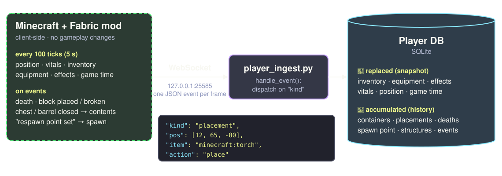

<!--
Mod: Minecraft 26.2, Fabric, Java 25, client-side only.
One persistent WebSocket connection, not HTTP. Python hosts the server, the mod connects out:
that way the whole Python side can be developed and tested without the game (player_simulate.py replays a JSONL file).
-->

---
<!-- _class: small -->

# Player DB: snapshots *and* history


* 🔄 **Snapshots** get replaced: inventory, vitals, position, … only *now* matters
* 📜 **History** accumulates: "Where did I put X?" is a question about the **past**
* 🔦 Placements: only notable blocks (torches, beds, furnaces, …), not every stone of a build
* 🧩 Read through fixed functions (`find_item`, `find_container`, `find_placements`, …), never text-to-SQL
* 🧭 Directions are computed in code: *"northeast, about 40 blocks away"*
* 🧪 Ingest is unit-tested over a real WebSocket, no mocks

<!--
Placements are an allowlist on purpose: missing an item type is better than logging 4000 stone blocks.
Chests/barrels are covered on screen close instead of on placement.
Bearing: atan2 on the X/Z deltas, Minecraft's north is -Z.
-->

---
<!-- _class: divider -->
<!-- header: '04 · Orchestrators in Detail' -->
<!-- _header: '' -->


###### 04
# The Orchestrators in Detail

Router first, then the ReAct agent

---

# Router: route → gather → answer

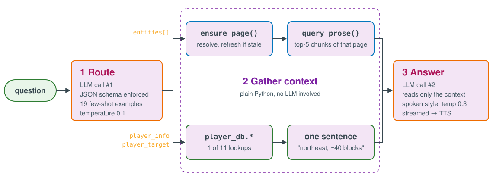

<!--
Model: qwen3:4b-instruct (~2.5 GB). Same model for both calls.
The model never decides HOW something is retrieved - gather_context() is deterministic Python.
-->

---
<!-- _class: small -->

# Step 1: route with a JSON schema

```
Q: "What does a wither skeleton drop?"
{"entities": ["Wither Skeleton"], "player_info": "none",       "player_target": null}

Q: "Where did I put my torches?"
{"entities": [],                  "player_info": "placements", "player_target": "torch"}
```

* 🧾 Ollama `format=` + JSON schema → the output always parses; `player_info` is an enum of 12 values
* 🎯 19 few-shot examples, one per category, temperature 0.1
* 💡 Without examples, *"How do I make a beacon?"* came back as **player state** with **no entity**

<!--
The 12 values: none, inventory, equipment, effects, vitals, position, spawn_point, deaths, game_time, containers, placements, structures.
player_target is only filled for categories that search by name.
-->

---
<!-- _class: small -->

# Steps 2 & 3: gather, then answer

**Gather**: plain Python, deterministic
* per entity: `ensure_page()` → `query_prose(title, question, k=5)`
* player info: one `player_db` lookup → one sentence of facts

**Answer**: one more call to the same model
* 📖 Only the given context. A gap means *"I don't know"*, not "it doesn't exist"
* 🗣️ Written for the ear: no lists, no markdown, *"you have…"*
* ⚡ Streamed: speech starts after the first sentence

✅ Fails gracefully: wrong page for "bingus bongus" → *"I don't know"* instead of nonsense

<!--
"A gap is not evidence of no": asked "where do I get gold?" with empty context, the model once said gold doesn't exist.
Small talk ("hey, how's it going?") is explicitly allowed without context.
-->

---

# ReAct agent: think → act → observe

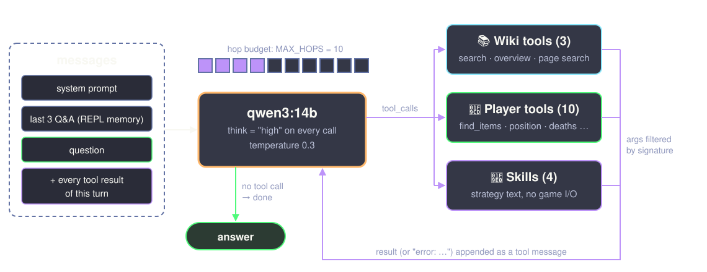

---
<!-- _class: small -->

# The agent loop in detail

* 🧠 `qwen3:14b` with `think="high"`: same model **family** as the router, so the comparison isolates the *architecture*
* 🔁 Up to `MAX_HOPS = 10` tool calls; then tools are withheld → one forced best-effort answer
* 🛡️ A failing tool returns `"error: …"` as a message and never crashes the turn
* 🧾 Tool descriptions are the Python **docstrings**, written for the model
* 🔒 No tool takes a file path, so a hallucinated argument can't redirect a read
* 💬 REPL memory: the last 3 question/answer pairs, not the tool transcripts
* ♻️ Reuses the router's modules: one new function in the whole codebase (`resolve.search_candidates`)

---
<!-- _class: small -->

# Tools & skills

| 📚 Wiki (3) | 🧍 Player (10) | 🧠 Skills (4) |
|---|---|---|
| `wiki_search_candidates` | `player_find_items` | `skill_crafting_chain` |
| `wiki_page_overview` | `player_inventory` | `skill_player_navigation` |
| `wiki_page_search` | `position` · `vitals` · `equipment` | `skill_category_lookup` |
| | `effects` · `spawn_point` · `deaths` | `skill_wiki_search_strategy` |
| | `placements` · `structures` | |

**Skills** are zero-argument tools that return *strategy text*, not game data.
They are pulled in on demand instead of bloating the system prompt: one hop, no I/O.

> 🧠 *"Don't search player_find_items for the category word itself (e.g. 'food') – real item names rarely contain it."*

---

# Worked example: chaining both sources

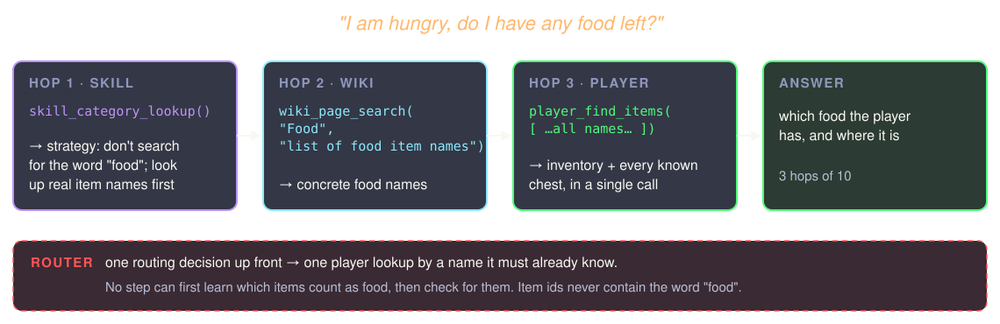

<!--
This is the path skill_category_lookup prescribes; it completed end to end live once wiki_page_search was capped (next chapter).
Router: it can fetch wiki pages AND player state in one pass, but the player lookup has to be decided up front.
-->

---
<!-- _class: divider -->
<!-- header: '05 · Comparison' -->
<!-- _header: '' -->


###### 05
# Comparison

❓ Can a model that chains lookups answer questions that need **both** sources?

---
<!-- _class: small -->

# Side by side

| | 🛤️ Router | 🔁 ReAct agent |
|---|---|---|
| **Model** | `qwen3:4b-instruct` · ≈ 2.5 GB | `qwen3:14b`, thinking · ≈ 9.3 GB |
| **LLM calls / question** | always 2 | 1 + one per tool round (≤ 10 tool calls) |
| **Who picks lookups** | Python, from one routing decision | the model, after every result |
| **Chained lookups** | ❌ single pass | ✅ read → decide → read |
| **Speed** | streamed, voice-ready | slow: thinking on every call |
| **Consistency** | same route → same lookups | same question can take different paths |
| **Memory** | none | last 3 Q&A (REPL) |
| **Interface** | live voice loop | text CLI (proof of concept) |

---
<!-- _class: small -->

# Which question, which architecture?

| Question | 🛤️ Router | 🔁 Agent |
|---|---|---|
| 📚 *"What does a wither skeleton drop?"* | ✅ one page, fast | ✅ slower |
| 🧍 *"Where did I put my torches?"* | ✅ exact lookup + direction | ✅ |
| 🗺️ *"How do I get back to where I died?"* | ✅ | ✅ |
| 🔗 *"I'm hungry, do I have any food left?"* | ⚠️ needs item names up front | ✅ *when* it consults the skill |

**Router:** fast & predictable for one-shot questions.
**Agent:** the only way to chain lookups, paid for in speed and predictability.

---
<!-- _class: divider -->
<!-- header: '06 · Drawbacks & Known Issues' -->
<!-- _header: '' -->

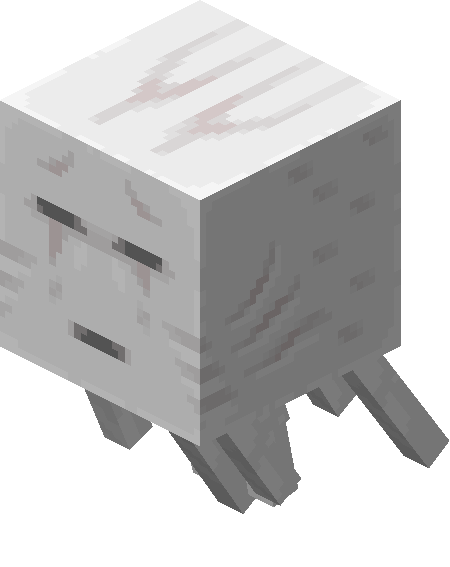

###### 06
# Drawbacks & Known Issues

---
<!-- _class: small -->

# Mechanical fixes stuck, prompt fixes mostly didn't

| Observed live (agent) | Rewording the prompt | Mechanical fix |
|---|---|---|
| 🪄 Made-up `term=` argument on a zero-argument skill → crash, hop wasted | – | drop arguments the function doesn't accept ✅ |
| 📋 Ollama's schema converter drops defaults → every parameter "required" | – | `param: T \| None = None` ✅ |
| 📚 Asked for 10 results → table dump → forgot the player check | reworded twice ❌ | hard cap at 3 results ✅ |
| 🔍 Two single-item tools → checked one source, gave up early | – | one `player_find_items(names)` ✅ |
| 💭 Thinking model puts everything into `thinking`, empty answer | – | one free re-prompt ✅ |

<!--
The schema bug was confirmed by reading ollama/_utils.py: type annotations are copied, default values are not.
Optional[T] = None is the one shape the converter does strip from "required".
-->

---
<!-- _class: small -->

# Known issues: orchestration

**🔁 ReAct agent**
* 🎲 Whether a matching skill gets consulted varies run to run: 3 of 4 runs, at temperature 0.3 **and** 0.1
* 🌡️ Temperature 0.1 made it worse: `player_inventory()` called 7× in a row, budget gone
* 🐌 Slow, and 14B (≈ 9.3 GB) doesn't fit the 4 GB target next to the game → not in the voice loop

**🛤️ Router**
* ➡️ One pass: it cannot look something up *because of* what it just read
* 🎯 A wrong routing decision means a wrong lookup, with no second chance
* 💬 No conversation memory in the voice loop: every question stands alone

---
<!-- _class: small -->

# Known issues: data & retrieval

* 🥈 Small embedding model: the right chunk is in the top-5, not always at #1
* 🔤 Search fallback can still pick a wrong page, and the alias cache then remembers it
* 🏷️ Inventory holds registry ids (`minecraft:cooked_beef`), the wiki uses titles ("Cooked Beef"): no bridge yet
* ⏳ First question about a new page pays fetch + parse + embed (Creeper, cold: 4.3 s incl. answer)
* 🧱 Mod: only containers you opened; furnaces & structure visits still TODO; Java Edition only; server mod to gather global information.
* 🕒 System only knows of the player's data; data of other players in the same world is not yet available.
* 📏 Evaluated by eye: batch prompt files + 89 unit tests, but no benchmark of answer quality

---
<!-- _class: divider -->
<!-- header: '07 · Future Work' -->
<!-- _header: '' -->


###### 07
# Future Work

---
<!-- _class: small -->

# Future work

**Next**
* 🌱 Pre-seed common pages; say a filler line (*"let me check the wiki…"*) on a cache miss
* 🔎 Resolve against a local index of verified page titles instead of keyword search

**Later**
* 🔀 **Hybrid:** the router as the fast path, hand over to the agent only for chained questions
* 🧩 Better chunks: page/section context in the embedding, smaller chunks, a re-ranker
* 🏷️ Map registry ids ↔ wiki titles
* 🗣️ Agent in the voice loop: smaller thinking budget, faster STT/TTS (faster-whisper, Piper)
* 💡 Proactive hints from the live event stream: night is falling, health is low, …
* 👥 Multiplayer support: system gathers server-side data, answers about other players in the same world

---
<!-- _class: title -->
<!-- _header: '' -->
<!-- _paginate: false -->
<!-- _footer: 'Minecraft images © Mojang Studios, via minecraft.wiki' -->


# Thank you! 🤠
## Questions?

github.com/lufeld/game-assistant
