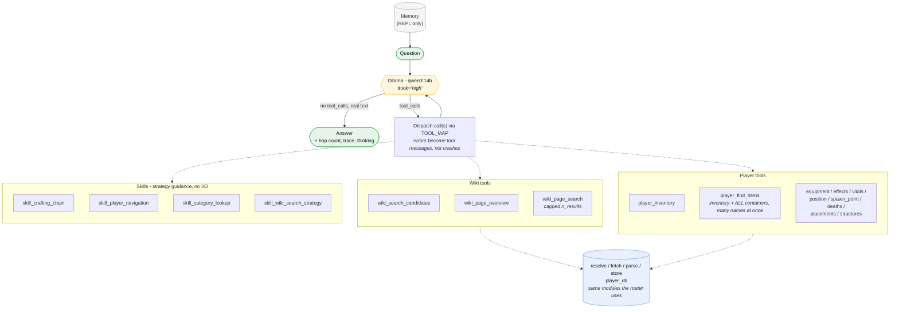

# Agent orchestrator (proof of concept)

A second, separate orchestrator that answers the same kinds of questions as
[`modules/orchestrator.py`](../orchestrator.py) (the router), but with a
different architecture: instead of one fixed routing decision followed by
one deterministic retrieval pass, a bigger model is given tools and allowed
to call them - reactively, one at a time, informed by each result - as many
times as it needs before answering.

This exists to answer a concrete question the router's single-pass design
can't: can chaining wiki knowledge together with player state produce better
answers for questions that need both? E.g. *"I am hungry, do I have any food
left?"* needs: find out what food items exist, then check whether the player
actually has any of them, carried or stored. The router can retrieve wiki
content *or* player state for a turn, but has no mechanism to decide "read
something, then decide what to read next based on what it found."

It is **not** wired into the voice loop - a separate text-to-text CLI only.
Latency is not a constraint here the way it is for the router; this trades
speed for (attempted) thoroughness, as a comparison, not a replacement.

## Architecture



`run_agent()` in [`orchestrator.py`](orchestrator.py) is the whole loop: call
Ollama with the full tool list; if it responds with `tool_calls`, dispatch
each one and feed the results back in as `tool`-role messages, then call
again; if it responds with plain text instead, that's the answer. This
repeats until either the model stops calling tools or `MAX_HOPS` is hit, at
which point tools are withheld from one final call to force a best-effort
answer instead of a bare truncation.

Model: `qwen3:14b` (~9.3GB, hybrid thinking), not the router's
`qwen3:4b-instruct` - deliberately a different size in the *same* model
family, so the comparison isolates architecture rather than conflating it
with a model swap. `think='high'` is on for every call (correctness over
latency was the explicit tradeoff accepted for this POC).

Almost everything is reused, not reimplemented. The only change to a shared
module across the whole codebase is one new function,
[`resolve.search_candidates()`](../wiki/resolve.py) - `resolve_title()`
itself, `parse.py`, `store.py`, `fetch.py`, `player_db.py`, and the router's
`orchestrator.py` are all untouched. See [Tools](#tools) for why that one
function was needed and nothing else was.

## Tools

Defined in [`tools.py`](tools.py), all with docstrings written for the model
(not a developer) since that text becomes the tool-schema `description` the
model actually sees - verified directly against Ollama's own schema
converter during development, not assumed.

**Wiki tools** (wrap `resolve.py` / `fetch.py` / `parse.py` / `store.py`,
exactly as the router uses them):
- `wiki_search_candidates(term, limit)` - full-text search, returns ranked
  candidate titles for the model to judge itself. Calls the new
  `resolve.search_candidates()`, *not* `resolve_title()` - the router's
  `resolve_title()` auto-picks `candidates[0]` and permanently caches that
  guess as an alias; letting the agent do that too would mean one bad guess
  silently poisons every future lookup (router's included) for that term,
  compounded across a multi-hop chain instead of risked once per turn. The
  agent sees the raw candidates and picks, so this path never touches the
  alias cache at all.
- `wiki_page_overview(title)` - summary + section headings for an
  already-known-reasonably-confident title. Calls the router's own
  `ensure_page()` directly (imported, not duplicated) - safe here because by
  the time this is called the title is either known outright or was just
  picked from real search candidates, so the underlying `resolve_title()`
  call should almost always hit its direct/alias path, not the risky
  auto-pick one.
- `wiki_page_search(title, query, n_results)` - semantic search within one
  page, the same `store.query_prose()` primitive `orchestrator.gather_context`
  uses, just callable repeatedly with different queries instead of once per
  turn. `n_results` is **capped at 3 regardless of what's requested** - see
  [Findings](#findings-from-live-testing).

**Player tools** (wrap `player_db.py` 1:1, no tool exposes `db_path` - kept
out of every schema so a hallucinated argument can't redirect a read):
`player_inventory`, `player_find_items`, `player_equipment`,
`player_effects`, `player_vitals`, `player_position`, `player_spawn_point`,
`player_deaths`, `player_find_placements`, `player_visited_structures`.

`player_find_items(names)` replaced an earlier `player_find_item` +
`player_find_in_containers` pair - see [Findings](#findings-from-live-testing)
for why. It checks every name in the list against both the inventory *and*
every known container in one call, returning a dict keyed by name.

**Skills** ([`skills.py`](skills.py)) are zero-argument tools that return
short strategy text instead of game data - a worked approach for a
recognizable question shape, retrieved on demand instead of always sitting
in the system prompt. `skill_crafting_chain`, `skill_player_navigation`,
`skill_category_lookup`, `skill_wiki_search_strategy` (the last one is a
direct, deliberate encoding of this project's own "black monster" →
"Minicraft" lesson from testing the router's search fallback).

## CLI

```
python orchestrator.py "<question>"              # one-shot, memory off
python orchestrator.py --batch prompts.txt        # one question per line, each independent
python orchestrator.py                            # interactive REPL, memory on (MEMORY_TURNS)
```

Flags: `--show-trace` (print each tool call + result), `--show-thinking`
(also print the model's reasoning per call and for the final answer, implies
`--show-trace`), `--no-memory` (disable REPL memory).

Memory, when on, replays only the final `(question, answer)` text of the
last `MEMORY_TURNS` turns into the next turn's messages - not the
intermediate tool-call transcript, so context doesn't accumulate every prior
turn's full exploration. A follow-up needing the same underlying fact just
re-fetches it.

## Findings from live testing

This is a proof of concept for *comparing* architectures, so what was
learned matters as much as the code. In rough order of how reliably an
intervention actually worked:

**Mechanical fixes stuck. Wording/prompt fixes mostly didn't.** That's the
one-line summary, and it held up consistently enough across multiple
independent cases to be worth stating plainly:

- Argument hallucination is real and silent-failure-prone. qwen3:14b called
  a zero-argument skill tool with a made-up `term` kwarg (likely
  pattern-matched from the neighboring `wiki_search_candidates(term, ...)`
  tool) - verified the auto-generated schema was correct
  (`"properties": {}`) before concluding this was model behavior, not a
  schema bug. A bare `fn(**arguments)` dispatch turned this into a hard
  `TypeError` that wasted the hop and meant the skill's actual guidance was
  never retrieved. Fixed by filtering `arguments` down to whatever the
  target function's own signature accepts before calling it - a mechanical
  fix, 100% reliable once in place.
- Ollama's Python-function-to-tool-schema conversion silently drops default
  values (confirmed by reading `ollama/_utils.py`'s actual
  `convert_function_to_tool` source, not assumed): it copies type
  annotations but never parameter defaults into the dynamically-built
  pydantic model, so every defaulted plain-typed parameter (`n_results: int
  = 3`) shows up as `"required"` in what the model sees - the model has no
  way to know it could omit it. `param: T | None = None` *is* handled
  correctly (the converter explicitly strips `null`-typed params from
  `required`), so `wiki_search_candidates`'s and `player_deaths`'s `limit`
  were changed to that pattern to get genuinely-optional treatment instead
  of just being documented as optional.
- A large `wiki_page_search` result reliably derailed the model. Observed
  live, twice, with two different (increasingly forceful) versions of
  `skill_category_lookup`'s guidance text: the model would request a big
  `n_results`, get a chunk full of tables back, and answer with a generic
  summary of *that* instead of continuing to the player-state check it
  still needed - abandoning the actual question despite most of the hop
  budget being unused. Tightening the skill's wording twice did not fix
  this. Hard-capping `n_results` at 3 regardless of what's requested did -
  confirmed via a follow-up live run that completed the full intended
  sequence (read page → check player state → answer) instead of derailing.
- `player_find_item(name)` + `player_find_in_containers(name)` as two
  separate, single-item tools meant the model would frequently check only
  one source, or check only one or two item names before giving up (e.g.
  guessing a food category might be present, checking 2-3 common names,
  then answering "no food" without ever finding the specific item actually
  present). Replaced with one `player_find_items(names)` tool that checks a
  whole list against both inventory and every container in a single call -
  verified live to produce comprehensive, correct multi-name,
  multi-source checks where the two-tool version hadn't.

**Things that were tried and didn't help, which is itself useful to know:**

- *Lower temperature for tool-selection, to reduce skill-consultation
  variance.* Tested directly: 4 repeated runs of the identical question at
  temperature 0.3 vs. 4 at 0.1 - the skill got consulted in 3/4 runs at
  *both* settings. No measurable difference. Worse, one of the four
  temperature-0.1 runs got stuck calling `player_inventory()` seven times
  in a row with identical arguments, burning the entire hop budget - a
  degenerate-repetition failure classically associated with near-greedy
  decoding, not present in any of the temperature-0.3 runs. Kept at 0.3.
- *Tightening skill guidance text further*, after the `n_results` cap was
  already in place, to address the separate, still-open finding that the
  model sometimes doesn't consult an applicable skill at all. Two identical
  questions run back-to-back after the cap fix: one correctly consulted the
  skill and completed the full process; the other skipped the skill
  entirely and fell back to the original naive behavior. Same code, same
  question, different outcome - this looks like inherent run-to-run
  consistency variance at this model size, not something reachable by
  further wording changes.

**Still-open, not chased further:** whether an applicable skill gets
consulted at all is inconsistent run-to-run, and this didn't move under
either temperature or prompt-wording changes - the two levers that would
normally be reached for first. Treated as a property of unconstrained
autonomous tool orchestration at this model size, not a bug - and a genuine
data point for the comparison this POC exists to make, since the router's
dispatch is fully deterministic and has no equivalent failure mode at all.

A defensive fix also went in for a different, structural symptom: a
hybrid-thinking model can put its entire response into `thinking` and leave
`content` empty while still signaling "done" (no `tool_calls`) - which reads
as the agent not replying at all. `run_agent()` now gives one free
re-prompt (not a tool call, doesn't cost a hop) for visible answer text
before falling back to an explicit `"(no answer text was produced)"` rather
than silent emptiness. The exact live trigger wasn't reproduced after
several attempts, but the mechanism is real and the fix is low-risk
regardless.

## Testing

```
pytest src/modules/agent/tests
```

16 tests, no live network/Ollama calls - `chat_fn` is a real injected
callable standing in for the network boundary (dependency injection, not
mocking, matching this repo's "real I/O over mocks" convention applied at
the one boundary that can't be real I/O in a fast unit test). Covers the
loop's control flow (hop counting, budget exhaustion, the empty-content
retry, memory folding) and structural properties of the tool wrappers (no
path parameters exposed, every tool has a docstring, `n_results` capping,
`player_find_items` checking both sources correctly).

`resolve.search_candidates()` has no automated test, consistent with the
rest of `resolve.py` (zero unit tests today - it's live-network-only,
exercised via its own `__main__` CLI, and inventing a live-network pytest
test would break that existing line). Verified manually instead; see the
function's own docstring.

Everything else is exercised manually, the same way the router is - see
[`prompts.txt`](prompts.txt) for a batch of comparison questions leaning
toward the multi-hop, cross-referencing shapes this architecture exists to
test (`python orchestrator.py --batch prompts.txt --show-trace`).

After any change to a function shared with the router (currently just
`resolve.py`), the router's own regression check still applies: diff
`python ../orchestrator.py --batch ../orchestrator_prompts.txt --show-routing`
output against a pre-change baseline.
